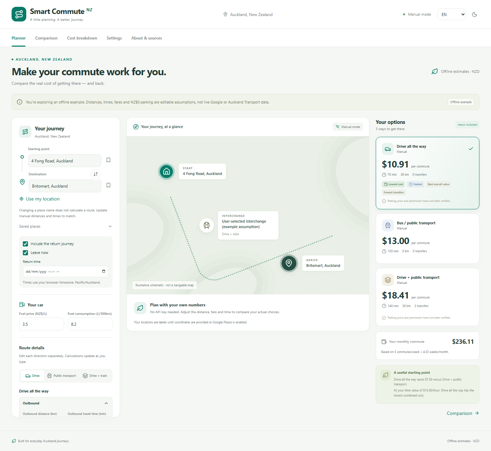

# Smart Commute NZ

**Auckland Travel Cost Optimizer** — compare driving, public transport and park-and-ride
using explainable NZD calculations. Designed for WHV holders, students, newcomers,
job seekers, and future integration with 蹲蹲.

[Live demo](https://gforgalen.github.io/smart-commute-nz/) ·
[Source](https://github.com/GFORGALEN/smart-commute-nz) ·
[Data sources](docs/DATA_SOURCES.md) · [Google Maps setup and costs](docs/GOOGLE_MAPS.md) ·
[AT integration plan](docs/AT_INTEGRATION.md)



[Mobile screenshot](docs/screenshots/mobile.png)

## Run locally

Requires Node.js 24 and npm. No API key, account, database, backend or paid AI service
is required. All monetary arithmetic is local TypeScript; no LLM API is used.

```sh
git clone https://github.com/GFORGALEN/smart-commute-nz.git
cd smart-commute-nz
npm ci
npm run dev
```

Open the URL printed by Vite (normally `http://127.0.0.1:5173`). For a production
build, run `npm run build` followed by `npm run preview`.

The first load needs access to the static assets. Production installs a service
worker that precaches the manual calculator, allowing reloads offline. It does
not cache Google Maps/Places or AT responses. Local development has no service worker.

## What works

- Three modes: drive, bus/train, and drive to a hub then public transport.
- Independently editable outward and return legs: distance, fuel consumption,
  travel time, fares, tolls and transfers; parking is one total charge per commute.
- Alternative driving routes and familiar-route saving. Google driving supports
  up to ten ordered stops through Places search or map clicks, with reorder/remove
  controls and automatic route refresh. Manual routes retain editable waypoint labels.
- Swap places, save places, request browser geolocation only on a button click.
- Fuel, parking, fares, tolls and optional maintenance breakdown; daily, weekly
  and monthly projections with editable commute frequency.
- Cheapest, fastest, fewest transfers, and time-value ranking. The generalized
  score is a decision metric, not an actual payable charge.
- English and Simplified Chinese; desktop and mobile layouts; local preferences.
- Vendor-independent core, optional Google Maps Routes/Places adapters and a dated
  Auckland Transport fare estimator with explicit limitations.

Incomplete return journeys are excluded from round-trip recommendations. AT fare
estimates require verified zones and transfer details; changed locations, times or
journey legs require reapplication. Quote verification is session-only, so saved AT
fares need review after a reload. Saved manual distances, prices and preferences remain
available offline.

The initial scenario is **sample input, not a Google/AT lookup**: 4 Fong Road →
Britomart, driving 19 km each way, park-and-ride driving 15 km each way, train
fare NZ$4.90 and public transport fare NZ$6.50 each way, fuel 8.2 L/100 km at
NZ$3.50/L, parking NZ$0. Durations are illustrative assumptions. In Manual Mode,
editing a location label does not change distance or fare. With Google available,
select locations in the left-hand address fields and plan a route; later address
or schedule changes refresh that route automatically. Station parking legality
and availability must be checked.

For those assumptions, full driving fuel is **NZ$5.453 one way / NZ$10.906 return**;
hybrid fuel plus fare is **NZ$9.205 one way / NZ$18.410 return**; full transit is
**NZ$6.50 one way / NZ$13.00 return**. Displayed currency rounds only at presentation.
These totals omit tolls and parking unless you enter them. Defaults are not today's
market petrol price and do not promise legal free parking.

## Optional Google Maps

Copy `.env.example` to `.env.local` and configure your own **browser** API key only
after reviewing the billing and setup guide. Do not send a key in chat.

```dotenv
VITE_GOOGLE_MAPS_API_KEY=your_restricted_browser_key
```

A Vite environment value is visible to site visitors; it is not a secret. Restrict
HTTP referrers and APIs, set quotas and billing alerts. With a configured key and an
online connection, Google Maps and address search load automatically. No-key or
offline sessions use Manual Mode. The first route calculation uses the left-hand
plan button; subsequent address, departure or return-time edits trigger a debounced
refresh. Fuel, parking, tolls and other cost changes recalculate locally without a
route request. Google distance and duration appear in the same journey editor and
the selected route is drawn on the main map. The planner uses traffic-aware driving
with the higher-priced Routes Pro SKU so departure times affect the route estimate.
Add driving stops below the origin/destination or use the map's **Add stop on map**
button. Stops are visited in the listed order; swapping endpoints and return journeys
reverse the order. Google transit cannot accept intermediate stops, so the planner
asks you to remove them or switch to driving. The transit editor links to AT Journey
Planner for official fare verification. A GTFS key alone cannot supply missing fares;
see the [AT integration plan](docs/AT_INTEGRATION.md).
When Google omits a usable NZD fare for a recognized AT bus/train, the planner keeps
the route and shows a standard adult HOP/contactless fare range. A normal integrated
journey is NZ$3.00–7.90; uncertain or separate transfers can widen it, and CityLink
uses its own tariff. Actual stop counts, lines and boarding/alighting stops are
displayed without treating stop counts as fare zones. Enter a confirmed whole-journey
fare or apply verified AT zones to replace the range; clearing the fare restores it.
Cost rankings use the upper end and disclose that assumption.
When the destination is chosen from Google address search, the planner looks up that place's
opening hours once per session and shows whether it is open at the expected arrival time
(departure plus the selected route's outbound duration). Opening hours are a Place Details
Enterprise field, so each new destination costs one Enterprise request; typed and map-picked
destinations are not looked up. Concessions and fare-cap
history are excluded from automatic ranges.
Never enable
billing or purchase a service without the account owner's consent. No paid service
was enabled by this project. A limited, owner-authorized live check on 9 October 2026
verified map loading, driving alternatives, address search and geocoding. Transit
returned routes but incomplete NZD fare information; the initial version required
manual pricing. The updated AT range flow was verified with six real transit
alternatives and stop metadata. A further bounded check verified automatic map
loading, traffic-aware one-way driving, destination-triggered route refresh and
immediate fuel-cost changes without another route request. Broader coverage and
return alternatives still need live verification. The public demo uses an owner-authorized
browser key supplied through the GitHub Actions repository secret
`VITE_GOOGLE_MAPS_API_KEY` during the final deployment build; the local `.env.local`
is not committed. Browser users can inspect the built key, so Google Cloud referrer/API
restrictions remain necessary. Opening the online planner loads Google services
automatically and can generate billable events; route planning and follow-up refreshes
can generate additional requests. Initialization or route errors leave Manual Mode
available. Unpriced services outside recognized AT bus/train routes require manual
fares; they never become free journeys.

## Reuse as a component or widget

The workspace packages are source packages (TypeScript), intended for bundlers.
They are not claimed to be published on npm.

```tsx
import { SmartCommutePlanner } from '@smart-commute/react';
// The workspace import includes the planner stylesheet; use a CSS-aware bundler.

<SmartCommutePlanner
  destination="Britomart, Auckland"
  origin="4 Fong Road, Auckland"
  locale="zh-CN"
  fuelPrice={3.5}
  fuelConsumption={8.2}
  theme="light"
  onRouteSelected={(route) => console.log(route.totalCost)}
/>;
```

`npm run build` also produces a standalone widget bundle in `dist-widget/`, copied
to the deployed `widget/` path. React is bundled so the host needs no framework.

```html
<link
  rel="stylesheet"
  href="https://gforgalen.github.io/smart-commute-nz/widget/smart-commute-widget.css"
/>
<div id="commute"></div>
<script type="module">
  import { mountSmartCommutePlanner } from 'https://gforgalen.github.io/smart-commute-nz/widget/smart-commute-widget.js';
  mountSmartCommutePlanner(document.getElementById('commute'), {
    destination: 'Britomart, Auckland',
    locale: 'en',
    theme: 'light',
  });
</script>
```

For style isolation, use an iframe. Set `destination`, optional `origin`, `locale`
and `theme` in the URL; URL-encode parameter values. Geolocation within an iframe
requires the host's permission policy and `allow="geolocation"`.

```html
<iframe
  title="Commute cost planner"
  width="100%"
  height="900"
  src="https://gforgalen.github.io/smart-commute-nz/?embed=1&destination=Britomart%2C%20Auckland&locale=zh-CN"
>
</iframe>
```

## Architecture

```text
apps/web              Complete app, static shell and standalone widget entry
packages/core         Types, cost calculation, projections and deterministic ranking
packages/providers    Manual/Google routes, AT fares and data source registry
packages/react        Reusable planner UI and persistence
packages/i18n         English and Simplified Chinese resources
tests/e2e             Desktop/mobile browser flows
docs                  Data provenance, API terms, decisions and screenshots
```

Extend `RouteProvider` for MapLibre/OSM/Valhalla without changing the cost engine.
Use `FareProvider` for additional cities. GTFS and GIS sources are registered and
documented; they are not routing services or guaranteed price/parking datasets.
No automatic station search, GTFS schedule engine, occupancy feed or ferry fare
estimator is included. See [decisions](docs/DECISIONS.md).

## Quality checks

```sh
npm run lint
npm run typecheck
npm run test
npm run build
npx playwright install chromium
npm run test:e2e
```

The CI also tests the production build under its Pages subpath, including offline
reloads and standalone widget embedding. Automated checks explicitly use an empty
Google key, so they make no paid Google requests. To reproduce on PowerShell when
you have a local key configured:

```powershell
$env:VITE_GOOGLE_MAPS_API_KEY=''
$env:VITE_BASE_PATH='/smart-commute-nz/'
npm run build
$env:PLAYWRIGHT_PRODUCTION='1'
npm run test:e2e
```

Core tests cover formulae, zero and invalid input, distinct return journeys,
parking, changing fuel/fare parameters, projections and deterministic rankings.
Provider tests use fake SDK responses as test fixtures (never product data).
React and browser tests exercise actual inputs and recommendations. See
[release validation](docs/TEST_RESULTS.md) for counts and limitations.

## GitHub Pages

The workflow runs lint, types, unit/component tests, build and desktop/mobile E2E,
with an empty Google key. After these checks pass, the final Pages build receives the
deployment browser key from the `VITE_GOOGLE_MAPS_API_KEY` repository secret. The workflow deploys
only successful `main` builds. In GitHub **Settings → Pages**, select
**GitHub Actions**. Public GitHub Pages is the intended static host.

The CI sets `VITE_BASE_PATH=/smart-commute-nz/` for the repository subpath. If you
rename the repository, change this value and links above. A custom domain/root
deployment should use `/`. Local Vite defaults to `/`; do not commit a real `.env`.

## Privacy, data and license

Preferences and user-entered places/routes stay in this browser's localStorage.
With a configured key, online startup loads Google Maps and address search. Address
search and route planning send entered locations to Google; after the first route
query, changing locations or schedules refreshes it automatically. Google
route content is transient and not saved into the offline shell or user preferences.
Weather comes from the free [Open-Meteo](https://open-meteo.com/) forecast API (CC BY 4.0,
non-commercial terms): each request sends the starting point rounded to about 1 km, or the
Auckland city centre when no coordinates are known, and responses stay in memory for about
ten minutes. Weather is a commute reference only and never changes costs or rankings.
The page has no analytics, authentication, server database or LLM calls.

Code is [MIT](LICENSE). Dependency licenses are recorded in
[third-party notices](docs/THIRD_PARTY_NOTICES.md). External data and Google content
retain their own licenses and terms. Verified fare sources and dates, concession
eligibility limits, transfer/cap caveats and unverified catalog licensing are listed
in the data source documentation. Contributions: [CONTRIBUTING](CONTRIBUTING.md).
